# Presentation Guide & Slide Deck Blueprint
## AI-Powered IT Incident Process Intelligence

A structured, concise, slide-by-slide guide designed for technical interviews, academic project presentations, and executive stakeholders.

---

## 🎯 Presentation Snapshot

- **Recommended Deck Length:** 10–12 Slides
- **Recommended Presentation Duration:** 10–15 Minutes (+ 5 Min Q&A)
- **Target Audience:** Placement Interviewers, Technical Leads, IT Operations Executives
- **Key Narrative Arc:** 
  1. *Problem:* Traditional ITSM aggregate KPIs hide operational queue friction and costly rework loops.
  2. *Solution:* Process Mining (PM4Py) + Leak-Free Machine Learning (Random Forest) + Interactive Console (Streamlit).
  3. *Impact:* Quantified 1.77x deviation penalty, 76.4% precision early warning for SLA breaches, and explainable ROI actions.

---

## 📑 Slide Deck Outline (Slide-by-Slide)

```mermaid
flowchart LR
    S1[1. Title] --> S2[2. Problem]
    S2 --> S3[3. Objectives]
    S3 --> S4[4. Architecture]
    S4 --> S5[5. Dataset]
    S5 --> S6[6. Process Mining]
    S6 --> S7[7. Bottlenecks]
    S7 --> S8[8. ML SLA Prediction]
    S8 --> S9[9. Explainable AI]
    S9 --> S10[10. Demo & UI]
    S10 --> S11[11. Business Impact]
    S11 --> S12[12. Q&A & Tech Stack]
```

---

### Slide 1: Title & Executive Summary
- **Slide Title:** AI-Powered IT Incident Process Intelligence
- **Subtitle:** Uncovering Hidden Workflow Friction and Predicting SLA Violations using Process Mining & Machine Learning
- **Presenter Name:** [Your Name / Candidate Name]
- **Bullet Points:**
  - **Core Domain:** Enterprise IT Service Management (ITSM) & ITIL Process Optimization.
  - **Core Technologies:** Python, PM4Py, Scikit-Learn, Streamlit, Plotly.
  - **Philosophy:** Inspired by Celonis process intelligence paradigms, built independently without proprietary dependencies.
- **Speaker Notes:**
  > *"Good morning. Today I am presenting an end-to-end Process Intelligence and Predictive Analytics platform for IT incident management. While traditional systems measure how long tickets take in hindsight, our system discovers how tickets actually flow through queues in real time and predicts SLA breaches before they happen."*

---

### Slide 2: The Business Problem & Motivation
- **Slide Title:** The Visibility Gap in Traditional IT Operations
- **Bullet Points:**
  - **Flawed High-Level Metrics:** Organizations rely on static averages (e.g., "Mean Time to Resolve: 24h") which obscure long-tail queue delays.
  - **Hidden Process Deviations:** Nearly 45% of tickets deviate from standard procedures due to re-assignment loops and uncoordinated handoffs.
  - **The Rework Penalty:** Reopened and escalated tickets consume disproportionate engineering bandwidth and multiply cycle times.
  - **Reactive Firefighting:** SLA alerts trigger *after* the violation has already impacted the customer.
- **Visuals:** A simple split graphic: *Reported Metrics (Smooth)* vs *Actual Execution (Chaos & Loops)*.
- **Speaker Notes:**
  > *"Average resolution time is often misleading. If 10 tickets take 2 hours and 2 tickets take 70 hours, the average looks acceptable, but customer satisfaction is compromised. In reality, handoff lag between teams and repeat ticket reopenings act as silent productivity sinks."*

---

### Slide 3: Project Objectives & Core Deliverables
- **Slide Title:** Project Scope & Objectives
- **Bullet Points:**
  - **Process Discovery:** Reconstruct end-to-end execution paths directly from event log timestamps.
  - **Variant Profiling:** Benchmark the optimal "Happy Path" against rework loops and escalations.
  - **Bottleneck Diagnostics:** Quantify wait times at each transition stage (Mean, Median, P90).
  - **Proactive SLA Risk Engine:** Predict SLA violations using early-stage ticket signals while strictly preventing data leakage.
  - **Explainable Operations Engine:** Translate mathematical process metrics into clear, rule-based triage recommendations.
- **Speaker Notes:**
  > *"Our goal was clear: bridge historical process mining with forward-looking machine learning. Instead of generating abstract process graphs, we turn event logs into concrete operational guidance."*

---

### Slide 4: System Architecture & Workflow
- **Slide Title:** Modular Architecture
- **Visual:** Architecture Flowchart (Mermaid)
- **Key Modules to Highlight:**
  - **Data Ingestion:** Multi-event lifecycle generator (`data_generator.py`) $\rightarrow$ 8,676 event records.
  - **Preprocessing:** Separation of case-level aggregates and leak-free feature vectors (`preprocessing.py`).
  - **Analytics Core:** PM4Py Direct-Follows Graph discovery + Random Forest classification pipeline.
  - **Delivery Layer:** 6-tab Streamlit dashboard with real-time risk simulation.
- **Speaker Notes:**
  > *"The architecture is cleanly decoupled into four layers: synthetic event log generation, leak-free feature preprocessing, analytical engines for process mining and machine learning, and an interactive Streamlit operations console."*

---

### Slide 5: The Lifecycle Event Dataset
- **Slide Title:** ITIL Incident Lifecycle Dataset
- **Bullet Points:**
  - **Volume:** 1,200 unique incident cases across 8,676 granular lifecycle event logs (90-day operational window).
  - **Schema:** `incident_id`, `activity`, `timestamp`, `incident_type`, `priority` (P1–P4), `severity`, `assigned_team`, `source`, `status`, `sla_target_hours`, `reopened`, `escalation_count`.
  - **Lifecycle Activities:**
    $$\text{Created} \rightarrow \text{Assessment} \rightarrow \text{Assignment} \rightarrow \text{Investigation} \rightarrow \text{Escalation} \rightarrow \text{Resolution} \rightarrow \text{Closed} \rightarrow \text{Reopened}$$
  - **Realistic Distributions:** Off-hours triage lags, team queue bottlenecks, and calibrated priority targets (P1: 4h $\rightarrow$ P4: 72h).
- **Speaker Notes:**
  > *"Unlike single-row incident summaries, this dataset captures true chronological event logs. Each ticket has multiple timestamped records representing state transitions, allowing us to compute exact stage-by-stage waiting times."*

---

### Slide 6: Process Mining & Variant Analysis
- **Slide Title:** Process Discovery: Happy Path vs. Deviations
- **Visual:** Refer to `screenshots/process_analysis.png` (Sankey transition map).
- **Key Empirical Metrics:**
  - **Happy Path (Standard Flow):**
    - **55.42%** of cases (665 tickets) follow the clean 6-step lifecycle.
    - Average Resolution: **22.18 hours** | SLA Breach Rate: **49.17%**.
  - **Deviant Paths (Escalated / Reopened / Rework):**
    - **44.58%** of cases (535 tickets) experience workflow deviations.
    - Average Resolution: **39.33 hours** | SLA Breach Rate: **77.76%**.
  - **Key Finding:** Deviant paths carry a **1.77x turnaround penalty** and a **28.6% higher SLA failure rate**.
- **Speaker Notes:**
  > *"Here is our first major finding. The standard happy path completes in 22 hours. But the moment a ticket deviates—through an escalation or reopening—resolution time jumps to 39.3 hours, an 77% increase in cycle time. Process mining quantifies this penalty immediately."*

---

### Slide 7: Bottleneck Diagnostics & Stage Delays
- **Slide Title:** Quantifying Queue Waiting Latency
- **Visual:** Refer to `screenshots/bottleneck_analysis.png` (Horizontal delay bar chart).
- **Empirical Findings Table:**
  | Transition Stage | Occurrences | Mean Delay | P90 Delay | Cumulative Wait |
  | :--- | :---: | :---: | :---: | :---: |
  | **Team Assignment $\rightarrow$ Investigation** | 1,159 | **15.86 hrs** | 36.68 hrs | 18,381.7 hrs |
  | **Incident Closed $\rightarrow$ Incident Reopened** | 114 | **13.11 hrs** | 22.07 hrs | 1,495.0 hrs |
  | **Incident Reopened $\rightarrow$ Investigation** | 114 | **8.50 hrs** | 16.42 hrs | 968.8 hrs |
  | **Escalation $\rightarrow$ Investigation** | 551 | **6.90 hrs** | 13.31 hrs | 3,803.9 hrs |
- **Takeaway:** Active engineering time is not the bottleneck; **inter-team queue dormancy** accounts for over 60% of total lifecycle duration.
- **Speaker Notes:**
  > *"Notice where tickets spend their time. The longest delay is not investigation itself, but the waiting queue between Team Assignment and Investigation—averaging nearly 16 hours. This proves that optimizing triage automation yields far greater gains than simply telling engineers to code faster."*

---

### Slide 8: Machine Learning SLA Risk Engine
- **Slide Title:** Proactive SLA Breach Prediction
- **Visual:** Refer to `screenshots/sla_prediction.png` (Confusion Matrix & Feature Importance).
- **Key Methodological Distinction:** **Zero Target Leakage**
  - Features used: Early indicators only (`priority`, `severity`, `team`, `source`, `initial_assessment_hours`, `time_to_assignment_hours`, `created_hour`, `is_weekend`).
  - Strict exclusion: No resolution durations, no close timestamps, no total escalations at close.
- **Empirical Model Performance (Test Set: N = 240):**
  - **Accuracy:** `68.75%`
  - **Precision:** `76.43%` *(Critical for avoiding alert fatigue)*
  - **Recall:** `71.81%`
  - **F1-Score:** `74.05%`
  - **ROC-AUC:** `74.45%`
- **Top 3 Predictive Factors:** Low Priority P4 target window, Initial assessment triage latency, Time to team assignment.
- **Speaker Notes:**
  > *"Many academic models achieve artificial 99% accuracy because they accidentally leak future information. We strictly isolated the feature vector to what is known in the first 30 minutes of a ticket's life. We achieved 76.4% precision and 74% F1-score, ensuring operational teams receive reliable early warnings without alert fatigue."*

---

### Slide 9: Explainable AI & Actionable Recommendations
- **Slide Title:** Translating Metrics into Action
- **Visual:** Refer to `screenshots/ai_recommendations.png` (Priority-badged recommendation cards).
- **Core Recommendations Generated:**
  1. **Mitigate Queue Lag (`REC-001` - Critical):** Implement pre-flight diagnostic checklists and automated assignment triggers for `Assignment -> Investigation`.
  2. **Rebalance Workload (`REC-004` - High):** Database Admin exhibits a 72.4% SLA breach rate due to concurrency bottlenecks; introduce Tier-1 deflection SOPs.
  3. **Address Ticket Reopenings (`REC-009` - Medium):** 9.5% overall reopening rate tied to Software Bugs; mandate post-fix health check verification before closure.
  4. **Automate Night Triage (`REC-010` - Medium):** Off-hours assessment lag is 2.2x slower than standard business shifts; deploy automated NLP categorization.
- **Speaker Notes:**
  > *"Data without recommendations is just noise. Our recommendation engine parses the process mining graph and team metrics to deliver priority-ranked action cards with expected operational impact, such as a 20-35% cycle time reduction."*

---

### Slide 10: Interactive Dashboard Walkthrough
- **Slide Title:** Operations Console Live Walkthrough
- **Visuals:** Grid or montage of `dashboard_overview.png`, `sla_prediction.png`, and `bottleneck_analysis.png`.
- **6 Core Capabilities:**
  - **Executive Overview:** High-level volume, compliance, and team benchmark matrix.
  - **Process Flow:** Interactive Plotly Sankey flow map with hover durations.
  - **Bottleneck Diagnostics:** Stage-by-stage distribution charts and escalation impact.
  - **Live Risk Simulator:** Interactive sliders and gauge meter predicting in-flight incident risk.
  - **AI Recommendations:** Filterable cards with quantitative supporting metrics.
  - **Incident Explorer:** Searchable audit trail displaying full event histories for any ticket ID.
- **Speaker Notes:**
  > *"The Streamlit application gives both executives and shift leads an interactive interface. In the SLA Simulator, a dispatcher can adjust incident parameters in real time and immediately see the risk gauge update alongside recommended interventions."*

---

### Slide 11: Business Impact & Strategic Value
- **Slide Title:** Strategic Business ROI
- **Bullet Points:**
  - **Cycle Time Reduction:** Addressing the 15.8h assignment lag can recover up to 25% of operational turnaround time.
  - **Reduced Rework Overhead:** Eliminating avoidable reopenings preserves senior engineering capacity for revenue-generating initiatives.
  - **SLA Breach Deflection:** Catching 71.8% of potential breaches in the first 30 minutes allows targeted escalation before customer penalties occur.
  - **Vendor Independence:** Provides Celonis-inspired process intelligence utilizing standard open-source tools (PM4Py, Scikit-Learn) with zero licensing costs.
- **Speaker Notes:**
  > *"From a financial perspective, this project demonstrates how open-source process intelligence can replicate multi-million-dollar enterprise capabilities. It transforms IT support from a reactive cost center into an optimized, data-driven workflow engine."*

---

### Slide 12: Summary, Future Work & Q&A
- **Slide Title:** Key Takeaways & Discussion
- **Summary Points:**
  - Fully functional, reproducible system tested with 6 automated test suites.
  - Successfully merged Process Mining (PM4Py) with Leak-Free Predictive Modeling (Random Forest).
- **Future Roadmap:**
  - Integration with streaming architectures (Kafka / Apache Flink) for continuous event mining.
  - Token-replay conformance checking against normative BPMN models.
  - Integration with local LLMs (e.g., Llama 3 via Ollama) to draft automated incident post-mortems.
- **Open for Questions!**
- **Speaker Notes:**
  > *"Thank you for your time. The codebase is fully modular, documented, and reproducible. I welcome your questions."*

---

## 💡 Anticipated Interview / Panel Questions & Answers

### Q1: "How did you ensure there is no data leakage in your ML model?"
> **Answer:** *"Data leakage occurs when features contain information from the future that wouldn't be available at prediction time. We strictly excluded total resolution hours, final closing timestamps, whether the ticket was reopened, and total escalations at close. We only used attributes known within the first 15–30 minutes: incident priority, severity, assigned team, reporting source, initial triage duration, time to team assignment, and creation timestamp features (hour of day, weekend flag)."*

### Q2: "Why choose Random Forest over Deep Learning (LSTM/Transformers)?"
> **Answer:** *"For tabular incident logs with ~1,200 cases and heterogeneous categorical features (teams, priorities), tree-based ensembles like Random Forest outperform deep neural networks in sample efficiency, resistance to overfitting, and explainability. Random Forest natively outputs feature importances, handles non-linear interactions between priority and queue delays, and can be evaluated and retrained on commodity hardware in seconds via Joblib."*

### Q3: "How does PM4Py integrate with your system? What happens if it isn't available?"
> **Answer:** *"We use PM4Py 2.7+ to discover Directly-Follows Graphs (DFG) and trace variant frequencies. However, following production resilience principles, we built a graceful fallback: if PM4Py is missing or fails due to system environment incompatibilities, our module automatically computes transition frequencies and stage latencies using native Pandas and NetworkX, ensuring the dashboard never crashes."*

### Q4: "Why are Low Priority (P4) incidents having high SLA breach predictive importance?"
> **Answer:** *"In our dataset, P4 incidents have a generous 72-hour window, but because teams naturally de-prioritize P4 tickets in favor of P1/P2 emergencies, P4 incidents frequently suffer extreme queue dormancy and breach their SLAs. The Random Forest model correctly picked up `priority_P4` as the strongest single categorical indicator of queue stagnation."*

---

## 📋 Quick Metric Cheatsheet for Presenters

Keep these exact verified numbers on hand during the demo:
- **Total Cases:** 1,200 | **Total Events:** 8,676
- **Mean Resolution Time:** 29.8 hours | **Median:** 24.0 hours
- **Overall SLA Breach Rate:** 61.9% | **Reopened Rate:** 9.5% | **Escalation Rate:** 35.7%
- **Happy Path Share:** 55.42% (22.18h avg turnaround)
- **Deviant Path Share:** 44.58% (39.33h avg turnaround $\rightarrow$ 1.77x slower)
- **Worst Queue Bottleneck:** `Team Assignment -> Investigation` (15.86h avg wait, 18,381.7h total lag)
- **ML Model Metrics (Test N = 240):**
  - Accuracy: **68.75%** | Precision: **76.43%** | Recall: **71.81%** | F1: **74.05%** | ROC-AUC: **74.45%**
- **Test Suite Status:** 6 of 6 Pytest unit tests passed (`pytest -v tests/test_basic.py`).
