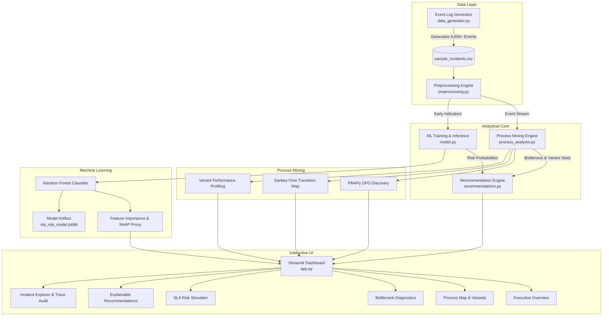
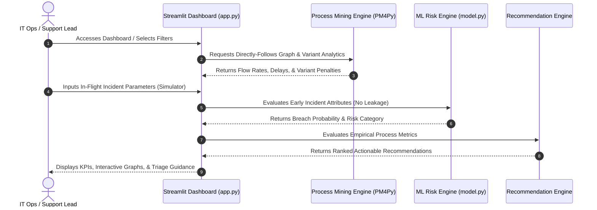
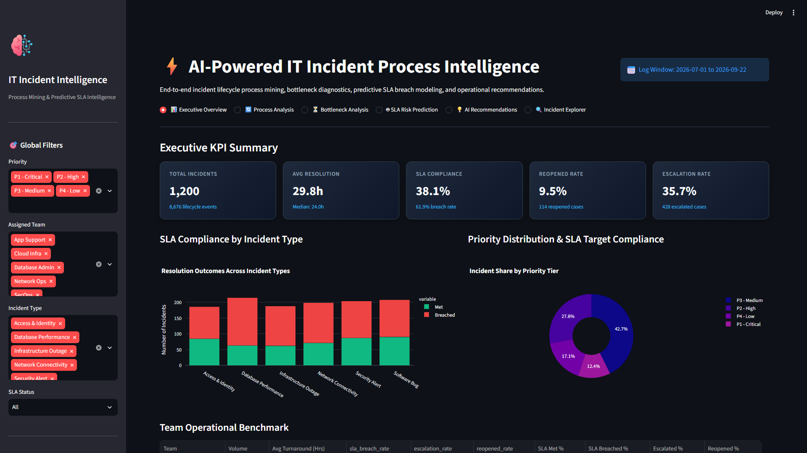
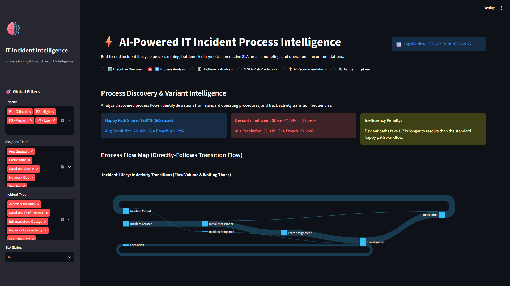
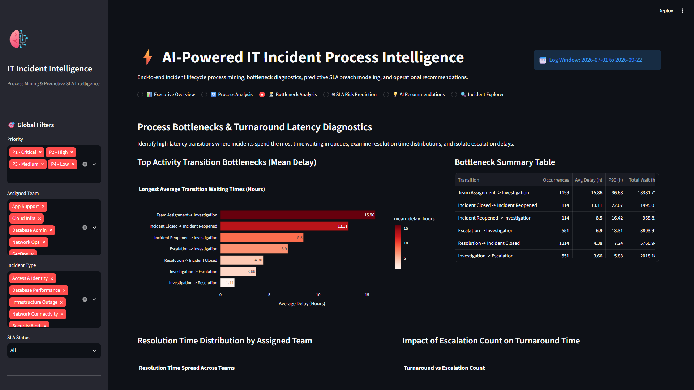
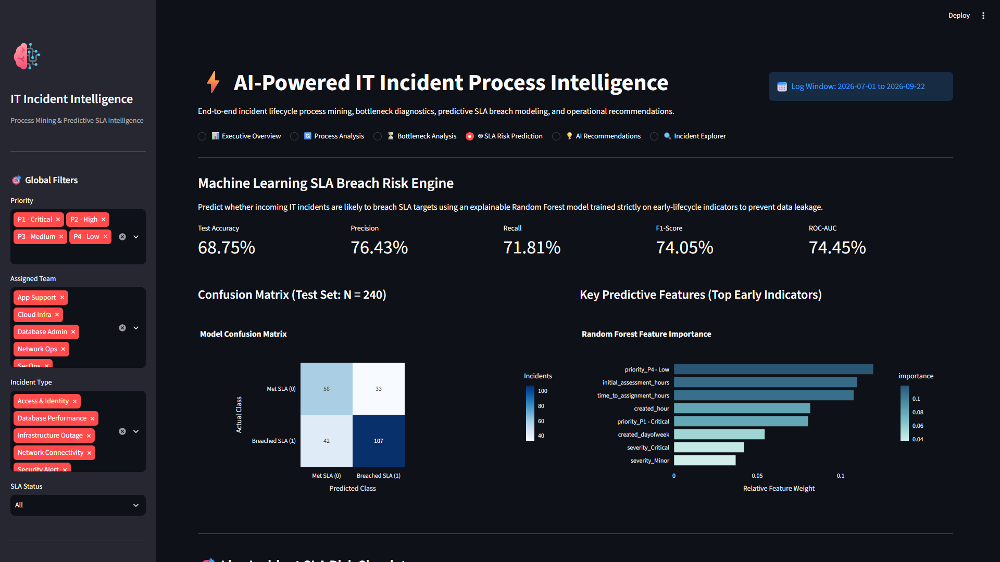
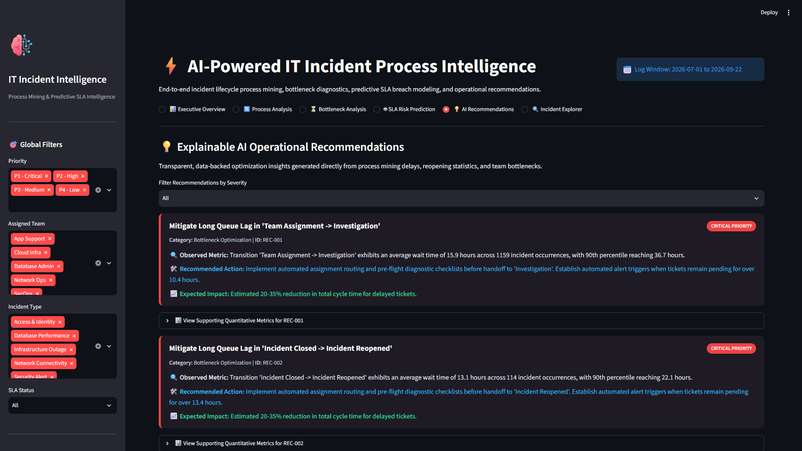

# AI-Powered IT Incident Process Intelligence

[](https://www.python.org/)
[](https://streamlit.io/)
[](https://pm4py.fit.fraunhofer.de/)
[](https://scikit-learn.org/)
[](LICENSE)

An enterprise-grade process intelligence and predictive incident analytics platform. Inspired by modern process mining paradigms (such as Celonis), this platform analyzes end-to-end ITIL incident management lifecycles to detect operational bottlenecks, uncover process variants, quantify deviation penalties, predict SLA violations before they occur, and deliver explainable, data-backed optimization recommendations.

---

## 📌 Table of Contents

- [Project Overview](#-project-overview)
- [Problem Statement](#-problem-statement)
- [Project Objectives](#-project-objectives)
- [System Architecture](#-system-architecture)
- [Process Workflow](#-process-workflow)
- [Key Features](#-key-features)
- [Dataset Description](#-dataset-description)
- [Process Mining Methodology](#-process-mining-methodology)
- [Predictive SLA Risk Engine](#-predictive-sla-risk-engine)
- [Empirical Results & Benchmark Metrics](#-empirical-results--benchmark-metrics)
- [Dashboard Walkthrough & Screenshots](#-dashboard-walkthrough--screenshots)
- [Repository Structure](#-repository-structure)
- [Installation & Setup](#-installation--setup)
- [Running the Application](#-running-the-application)
- [Automated Testing](#-automated-testing)
- [Limitations & Future Improvements](#-limitations--future-improvements)
- [Disclaimer](#-disclaimer)
- [Author & Contact](#-author--contact)

---

## 🔎 Project Overview

In enterprise IT organizations, Service Desks and Engineering Support teams manage thousands of incident tickets daily across multiple specialized queues. Traditional IT Service Management (ITSM) reporting relies on static aggregates (such as monthly mean time to resolve), which obscure the actual underlying execution pathways, hidden queue loops, handoff latencies, and triage bottlenecks.

This project bridges that gap by combining **Process Mining (via PM4Py & transition network analysis)** with **Explainable Machine Learning (Random Forest classification)** and an **interactive Streamlit operations console**. It provides full transparency into the actual execution traces of IT incidents, contrasts standard happy paths with inefficient rework loops, and proactively flags high-risk tickets while intervention is still possible.

---

## 🚨 Problem Statement

IT operations teams frequently struggle with:
1. **Opaque Queue Latency:** Incidents sit idle between assignment and active investigation without detection.
2. **Costly Rework Loops:** Unresolved root causes trigger frequent ticket reopenings and repeated escalations, inflating resolution costs by 1.7x to 2.5x.
3. **Reactive SLA Management:** Operations managers only discover SLA violations after breaches occur, when customer satisfaction is already damaged.
4. **Data Leakage in Predictive Models:** Naive ML approaches often introduce target leakage (e.g., using final resolution times or post-close logs to predict breaches), rendering them useless in live operational environments.

---

## 🎯 Project Objectives

- **Discover Real Process Flows:** Automatically reconstruct the end-to-end incident lifecycle from event timestamps and activity sequences.
- **Isolate Bottlenecks:** Quantify stage delays (mean, median, 90th percentile) and isolate queue transitions causing maximum operational drag.
- **Quantify Variant Inefficiencies:** Benchmark the primary standard "Happy Path" against deviant, escalated, and reopened paths.
- **Proactive SLA Breach Prediction:** Train a leak-free Machine Learning model using only signals available in the early stages of an incident.
- **Prescribe Data-Driven Actions:** Generate transparent, rule-based operational recommendations tied directly to empirical metrics.

---

## 🏗️ System Architecture



---

## 🔄 Process Workflow



---

## 🌟 Key Features

1. **Process Discovery & Variant Intelligence:**
   - Discovers Directly-Follows Graphs (DFG) using PM4Py and computes transition probabilities.
   - Interactive Plotly Sankey flow diagram illustrating transition volume and average delay.
   - Comparative analytics showing how deviant variants multiply resolution duration.
2. **Stage Delay & Bottleneck Diagnostics:**
   - Computes Mean, Median, P90, and Cumulative waiting times for all activity transitions.
   - Team-by-team resolution distribution and escalation delay breakdown.
3. **Leak-Free SLA Breach Prediction:**
   - Random Forest model trained solely on early-lifecycle data (Priority, Severity, Team, Source, Initial Assessment Delay, Creation Hour/Day).
   - Prevents data leakage by excluding downstream outcomes, final durations, and post-investigation events.
   - Real-time interactive SLA Risk Simulator with gauge meter and risk categorization.
4. **Explainable AI Recommendations:**
   - Automated, rule-based recommendation cards categorizing severity (Critical, High, Medium).
   - Clear supporting empirical metrics and expected operational impact estimates.
5. **Incident Explorer & Audit Trace:**
   - Searchable case registry with filter criteria.
   - Deep-dive inspector displaying the full chronological event log and status transitions for any selected ticket.

---

## 📊 Dataset Description

The system includes a realistic synthetic IT incident dataset comprising **1,200 unique incident cases** and **8,676 event log records**, spanning 90 days of operations.

### Schema:
| Column | Type | Description |
| :--- | :--- | :--- |
| `incident_id` | String | Unique incident identifier (e.g., `INC-10042`) |
| `activity` | String | Lifecycle event name (`Incident Created`, `Initial Assessment`, `Team Assignment`, `Investigation`, `Escalation`, `Resolution`, `Incident Closed`, `Incident Reopened`) |
| `timestamp` | Datetime | ISO timestamp (`YYYY-MM-DD HH:MM:SS`) |
| `incident_type` | String | Category (`Infrastructure Outage`, `Database Performance`, `Software Bug`, `Access & Identity`, `Network Connectivity`, `Security Alert`) |
| `priority` | String | ITIL Priority Tier (`P1 - Critical`, `P2 - High`, `P3 - Medium`, `P4 - Low`) |
| `severity` | String | Incident Severity (`Critical`, `Major`, `Moderate`, `Minor`) |
| `assigned_team` | String | Support group (`Service Desk`, `Network Ops`, `Cloud Infra`, `Database Admin`, `SecOps`, `App Support`) |
| `source` | String | Ingestion channel (`Monitoring Alert`, `User Portal`, `Email`, `Phone Call`, `Automated Script`) |
| `status` | String | Ticket status (`New`, `In Progress`, `Escalated`, `Resolved`, `Closed`) |
| `resolution_time_hours` | Float | Total turnaround duration in hours |
| `sla_target_hours` | Float | Target SLA limit based on priority (P1: 4h, P2: 12h, P3: 24h, P4: 72h) |
| `reopened` | Integer | Binary flag (1 if ticket was reopened, 0 otherwise) |
| `escalation_count` | Integer | Total count of tier escalations during ticket lifecycle |

---

## 🔬 Process Mining Methodology

Process mining analyzes historical event logs to discover, monitor, and improve real-world business processes.

1. **Directly-Follows Graph (DFG):** Discovers all directed transitions $(A \rightarrow B)$ where activity $B$ occurs immediately after activity $A$ in a given case.
2. **Process Variant Analysis:** Groups cases by their exact ordered activity execution sequence. Variant #1 represents the standard operating procedure ("Happy Path"), while succeeding variants capture edge cases, loops, and escalations.
3. **Transition Waiting Time:** Measures queue latency between consecutive activities:
   $$\Delta t_{transition} = t(A_{i+1}) - t(A_i)$$
4. **Native PM4Py Integration with Graceful Fallback:** Uses PM4Py 2.7+ for formal graph discovery. If PM4Py is unavailable in an environment, the system automatically falls back to an internal Pandas and NetworkX process mining engine without crashing.

---

## 🤖 Predictive SLA Risk Engine

### Preventing Data Leakage
A critical flaw in incident ML systems is data leakage. Training models on features that include post-investigation information produces deceptively high test scores that collapse in production. This platform enforces strict early-stage feature boundaries:

- **Included Features:** `incident_type`, `priority`, `severity`, `assigned_team`, `source`, `initial_assessment_hours`, `time_to_assignment_hours`, `created_hour`, `created_dayofweek`, `is_weekend`, `is_offhours`.
- **Strictly Excluded:** `resolution_time_hours`, total `escalation_count` at closure, `reopened` status, end timestamps, and downstream resolution notes.

### Model Architecture
- **Pipeline:** `ColumnTransformer` with `OneHotEncoder(handle_unknown='ignore')` + `StandardScaler()`.
- **Classifier:** `RandomForestClassifier(n_estimators=120, max_depth=12, class_weight='balanced', random_state=42)`.
- **Validation:** 80/20 stratified train/test split.

---

## 📈 Empirical Results & Benchmark Metrics

The following metrics were measured by executing the application pipeline on the generated 1,200 case dataset:

### 1. Operational Overview
- **Total Incidents Analyzed:** 1,200
- **Total Lifecycle Events:** 8,676
- **Average Incident Turnaround:** 29.8 hours (Median: 24.0 hours)
- **Overall SLA Compliance Rate:** 38.1% (61.9% breach rate)
- **Ticket Reopen Rate:** 9.5% (114 cases)
- **Escalation Rate:** 35.7% (428 cases)

### 2. Process Variant Comparison
| Metric | Standard Happy Path | Deviant / Inefficient Paths | Penalty Multiplier |
| :--- | :---: | :---: | :---: |
| **Share of Cases** | 55.42% (665 cases) | 44.58% (535 cases) | - |
| **Average Resolution** | 22.18 hours | 39.33 hours | **1.77x Longer** |
| **SLA Breach Rate** | 49.17% | 77.76% | **+28.59% Breaches** |

### 3. Top Process Bottlenecks
| Transition | Occurrences | Mean Delay | P90 Delay | Total Waiting Time |
| :--- | :---: | :---: | :---: | :---: |
| `Team Assignment -> Investigation` | 1,159 | **15.86 hrs** | 36.68 hrs | 18,381.7 hrs |
| `Incident Closed -> Incident Reopened` | 114 | **13.11 hrs** | 22.07 hrs | 1,495.0 hrs |
| `Incident Reopened -> Investigation` | 114 | **8.50 hrs** | 16.42 hrs | 968.8 hrs |
| `Escalation -> Investigation` | 551 | **6.90 hrs** | 13.31 hrs | 3,803.9 hrs |

### 4. Machine Learning Model Evaluation (Test Set: N = 240)
| Metric | Score |
| :--- | :---: |
| **Test Accuracy** | **68.75%** |
| **Precision (SLA Breach)** | **76.43%** |
| **Recall (SLA Breach)** | **71.81%** |
| **F1-Score** | **74.05%** |
| **ROC-AUC** | **74.45%** |

#### Confusion Matrix:
$$\begin{pmatrix} \text{True Negatives (Met SLA): } 58 & \text{False Positives: } 33 \\ \text{False Negatives: } 42 & \text{True Positives (Breached): } 107 \end{pmatrix}$$

#### Top Predictive Feature Weights:
1. `priority_P4 - Low`: 0.1196
2. `initial_assessment_hours`: 0.1099
3. `time_to_assignment_hours`: 0.1079
4. `created_hour`: 0.0818
5. `priority_P1 - Critical`: 0.0805

---

## 🖼️ Dashboard Walkthrough & Screenshots

### 1. Executive Overview
Comprehensive KPI scorecards, SLA compliance distribution by category, priority tier share, and operational benchmark table.



---

### 2. Process Analysis & Flow Discovery
Directly-Follows transition Sankey diagram, Happy Path vs Deviant path comparison, and process variants breakdown.



---

### 3. Bottleneck Analysis & Latency Diagnostics
Ranked queue delay analysis, resolution spread by assigned group, and escalation impact modeling.



---

### 4. SLA Risk Prediction & Live Simulator
Evaluation metrics, confusion matrix, feature importance weights, and real-time interactive incident risk simulator.



---

### 5. AI Recommendations
Explainable, priority-badged recommendations with supporting empirical evidence and suggested remediation actions.



---

## 📂 Repository Structure

```text
ai-powered-it-incident-process-intelligence/
├── app.py                     # Main interactive Streamlit application
├── requirements.txt           # Production dependencies
├── README.md                  # Comprehensive technical documentation
├── .gitignore                 # Standard Python/IDE ignore rules
├── data/
│   └── sample_incidents.csv   # 1,200 incident lifecycle event logs (8,600+ rows)
├── src/
│   ├── __init__.py            # Package root
│   ├── data_generator.py      # Synthetic ITIL event log generator
│   ├── preprocessing.py       # Case aggregator & leak-free feature extraction
│   ├── process_analysis.py    # PM4Py discovery, variants & bottleneck engine
│   ├── model.py               # ML Random Forest pipeline, evaluation & joblib
│   └── recommendations.py     # Data-driven explainable recommendation engine
├── models/
│   ├── .gitkeep               # Directory placeholder
│   └── sla_risk_model.joblib  # Trained Random Forest pipeline artifact
├── tests/
│   └── test_basic.py          # Pytest unit and integration test suite
└── screenshots/
    ├── README.md              # Screenshot catalog description
    ├── dashboard_overview.png # Genuine Executive Overview capture
    ├── process_analysis.png   # Genuine Process Flow capture
    ├── bottleneck_analysis.png# Genuine Bottlenecks capture
    ├── sla_prediction.png     # Genuine ML Evaluation capture
    └── ai_recommendations.png # Genuine AI Recommendations capture
```

---

## 💻 Installation & Setup

### Prerequisites
- Python 3.10 or 3.11
- Git

### 1. Clone the Repository
```bash
git clone https://github.com/your-username/ai-powered-it-incident-process-intelligence.git
cd ai-powered-it-incident-process-intelligence
```

### 2. Create and Activate a Virtual Environment
```bash
# Windows (PowerShell)
python -m venv venv
.\venv\Scripts\Activate.ps1

# Linux / macOS
python3 -m venv venv
source venv/bin/activate
```

### 3. Install Dependencies
```bash
pip install --upgrade pip
pip install -r requirements.txt
```

---

## 🚀 Running the Application

Launch the Streamlit interactive dashboard:
```bash
streamlit run app.py
```
Open your browser and navigate to `http://localhost:8501`.

### Regenerating the Dataset (Optional)
To regenerate a fresh synthetic dataset directly from the CLI:
```bash
python -m src.data_generator
```

### Retraining the Machine Learning Model (Optional)
To retrain and evaluate the model artifact:
```bash
python -m src.model
```

---

## 🧪 Automated Testing

Run the test suite using `pytest`:
```bash
pytest -v tests/test_basic.py
```

### Test Suite Coverage:
- `test_data_generator`: Verifies schema completeness, record counts (>1,000 cases), and absence of null values in primary keys.
- `test_case_aggregation`: Validates case durations and verifies zero data leakage in feature sets.
- `test_transitions_and_bottlenecks`: Asserts transition sequence validity and sorting of stage delays.
- `test_process_variants_and_pm4py`: Tests PM4Py DFG discovery and variant frequency ranking.
- `test_model_training_and_prediction`: Validates training, evaluation score bounds, Joblib persistence, and real-time inference.
- `test_recommendation_engine`: Confirms structured, data-backed operational recommendation generation.

---

## ⚠️ Limitations & Future Improvements

1. **Synthetic Data Boundaries:** While modeled on realistic ITIL distributions and queue delays, the dataset is synthetic and does not capture human organizational politics or undocumented side-channel communications.
2. **Online Learning:** The current Random Forest model operates on batch training; integrating incremental learning (e.g., River or online SGD) could support real-time streaming updates.
3. **Advanced Conformance Checking:** Future releases can integrate token-replay conformance checking against normative BPMN process models to measure exact fitness and precision scores.
4. **LLM Root Cause Synthesis:** Integrating local Small Language Models (e.g., Llama 3 via Ollama) could translate rule-based recommendation metrics into customized executive email briefings.

---

## 📢 Disclaimer

This is an independent process intelligence project inspired by Celonis concepts and ITIL process optimization frameworks. It does not claim official Celonis affiliation or utilize proprietary Celonis software. All data analyzed within this repository is synthetically generated and contains no real personal, proprietary, or organizational information.

---

## 👤 Author & Contact

**Project Lead:** Balap (balap)  
**Role:** AI/ML & Process Mining Engineer  
**GitHub:** [https://github.com/your-username](https://github.com/your-username)  
**LinkedIn:** [https://linkedin.com/in/your-profile](https://linkedin.com/in/your-profile)  
**Email:** your-email@example.com
